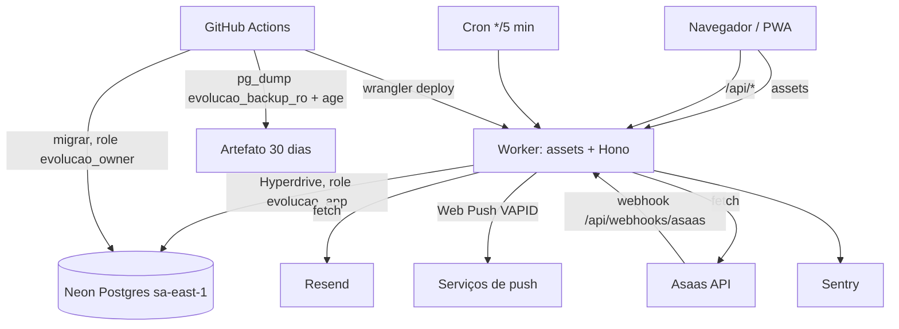
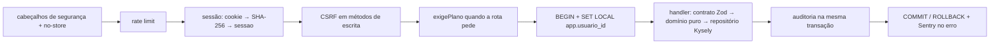

# SDD: Evolução Segura

> Documento de desenho derivado de [design.md](../.specs/features/evolucao-segura/design.md) e [spec.md](../.specs/features/evolucao-segura/spec.md). O design é a fonte; este arquivo o resume para quem entra no projeto. Fatos técnicos citados como [P-n] estão na seção Fontes do design (pesquisa de 2026-10-24).

## 1. Visão geral

Um único Worker serve o front (assets) e a API Hono em `/api/*`. Todo acesso ao banco passa pela API, numa transação por requisição com `SET LOCAL app.usuario_id`; o RLS barra o resto. Tarefas agendadas (lembretes, plano, purga) rodam no mesmo Worker por um único Cron Trigger e só tocam o banco por funções `SECURITY DEFINER` estreitas, para que a role `evolucao_app` continue sem DELETE e sujeita a RLS.

## 2. Pipeline de uma requisição `/api/*`

Rotas públicas (cadastro, entrar, 2FA, recuperação, confirmação, desistência, webhook, health) pulam a sessão e o CSRF. O webhook pula também o rate limit público e usa o `LIMITE_WEBHOOK`.

## 3. Componentes

| Pacote         | Responsabilidade                                                                                                 | Local                            |
| -------------- | ---------------------------------------------------------------------------------------------------------------- | -------------------------------- |
| `@es/contrato` | Schemas Zod e tipos compartilhados entre API e front; códigos de erro                                            | `backend/contrato/src/<area>.ts` |
| `@es/dominio`  | Regras puras, sem I/O (transições de status, séries, conflitos, débito, estado da assinatura, política de senha) | `backend/dominio/src/<area>/`    |
| `@es/api`      | Worker Hono: rotas, middlewares, repositórios, tarefas do cron, clientes de Resend, Asaas e push                 | `backend/api/src/`               |
| `@es/scripts`  | `migrar.ts` (node-pg-migrate 9, ESM), `seed-local.ts`, scripts de operação; migrations                           | `backend/scripts/`               |
| `@es/web`      | Landing e páginas públicas em `/`, app em `/app`, PWA; PDF e zip no navegador, sob demanda                       | `frontend/web/src/`              |

Dependências: `@es/dominio` depende de `@es/contrato`; `@es/api` depende dos dois; `@es/web` depende de `@es/contrato`.

### Tarefas do cron

Um despachante chamado a cada 5 minutos roda, em ordem e com orçamento de CPU: lembrete de sessão (janela de 15 a 10 minutos), pendência das 20:00, avisos de plano, transições de assinatura (trial vencido, atraso de 7 dias, cancelada no fim), purga de contas e limpeza de tokens vencidos. Cada tarefa é idempotente pela tabela `notificacao_enviada` (tipo, ref, chave única) ou pelo estado.

## 4. Modelo de dados

Toda tabela de negócio tem `usuario_id`, RLS com `FORCE` e `criado_em`; as editáveis têm `row_version`. A role `evolucao_app` não tem DELETE em tabela de negócio.

| Área                                                      | Tabelas                                                                                                                                    |
| --------------------------------------------------------- | ------------------------------------------------------------------------------------------------------------------------------------------ |
| Base                                                      | roles `evolucao_owner`, `evolucao_app`, `evolucao_backup_ro`; schema `tarefas`; `app_usuario_id()`; triggers de `row_version` e de revisão |
| Identidade (sem RLS, acesso por funções e grants mínimos) | `usuario`, `credencial_senha`, `sessao`, `desafio_2fa`, `token_email`, `tentativa_login`, `aceite_termos`                                  |
| Limites                                                   | `limite_uso`                                                                                                                               |
| Perfil                                                    | `perfil`, `configuracao_usuario`                                                                                                           |
| Anamnese                                                  | `modelo_anamnese`, `modelo_anamnese_item`, `anamnese`, `anamnese_retificacao`                                                              |
| Pacientes                                                 | `paciente`, `consentimento_tcle`                                                                                                           |
| Agenda                                                    | `serie_recorrencia`, `sessao_atendimento`                                                                                                  |
| Evolução                                                  | `evolucao`, `evolucao_retificacao`, `rascunho`, `modelo_texto`                                                                             |
| Financeiro                                                | `preco_paciente`, `preco_sessao`, `pagamento`                                                                                              |
| Auditoria                                                 | `audit_log` (só inclusão)                                                                                                                  |
| Cobrança                                                  | `assinatura`, `webhook_evento`                                                                                                             |
| Push                                                      | `push_subscription`, `notificacao_enviada`                                                                                                 |
| Exclusão                                                  | `conta_excluida`                                                                                                                           |

Estados da assinatura: `trial`, `ativa`, `atrasada`, `cancelada`, `free`. O campo `plano` é `pro` ou `free`; `pro` cobre trial, ativa, atrasada e cancelada até `periodo_fim`.

## 5. Tratamento de erros

| Cenário                           | Tratamento                                                                                                                                                 |
| --------------------------------- | ---------------------------------------------------------------------------------------------------------------------------------------------------------- |
| Validação de contrato             | 422 problem+json com `codigo` e campos                                                                                                                     |
| Recurso de outro profissional     | 404 idêntico ao de inexistente (RLS devolve zero linhas)                                                                                                   |
| Conflito de versão                | 409                                                                                                                                                        |
| Limite do plano                   | 403 `LIMITE_PLANO`                                                                                                                                         |
| Resend fora ou sem cota           | 503 `mail_unavailable` no 2FA; 202 nos fluxos anti-enumeração; alerta no Sentry                                                                            |
| Asaas fora                        | 503 sem mudar o estado local                                                                                                                               |
| Webhook com erro de processamento | grava `webhook_evento` antes de processar; erro vira 500 para o Asaas reenviar (a fila pausa após 15 falhas seguidas [P-4]); o runbook explica reprocessar |
| Push 404 ou 410                   | remove a `push_subscription`                                                                                                                               |
| Erro não previsto                 | 500 genérico, Sentry com scrubbing, transação desfeita                                                                                                     |
| Neon em cold start                | sem tratamento especial; a espera não conta na CPU                                                                                                         |

## 6. Decisões técnicas

| Decisão                          | Escolha                                                                                             |
| -------------------------------- | --------------------------------------------------------------------------------------------------- |
| Conexão ao banco                 | `pg.Client` por requisição via Hyperdrive, envolvido pelo Kysely; `client.end()` em `ctx.waitUntil` |
| Tarefas e webhook fora da sessão | Funções `SECURITY DEFINER` no schema `tarefas`, executáveis pela role `evolucao_app`                |
| Cron                             | Um trigger `*/5 * * * *` com despachante (5 crons por conta, divididos entre 3 apps)                |
| Push                             | `@block65/webcrypto-web-push` com payload cifrado                                                   |
| PDF e zip                        | pdfmake e `fflate` no navegador, em chunk sob demanda                                               |
| Testes do Worker                 | `@cloudflare/vitest-plugin` com Hyperdrive local por `miniflare.hyperdrives` (AD-001, ADR-003)      |
| Commits                          | Um commit atômico por tarefa; relatório LJS ao fechar cada etapa (AD-002)                           |
| Postgres                         | 16 no Docker, no CI e no Neon                                                                       |
| Migrations                       | node-pg-migrate 9 (ESM)                                                                             |

## 7. Plano em etapas

As 15 etapas do design, com requisitos, riscos e ADRs, estão em [design.md](../.specs/features/evolucao-segura/design.md) (seção "Plano em etapas") e viram fases do [tasks.md](../.specs/features/evolucao-segura/tasks.md).

## 8. Riscos

A tabela completa está no design, seção Risks & Concerns. Os que mudam o desenho dependem dos spikes S1 (Hyperdrive, Kysely e `SET LOCAL`), S2 (rate limit no Free), S3 (Asaas sandbox) e S4 (Web Push no Worker).
