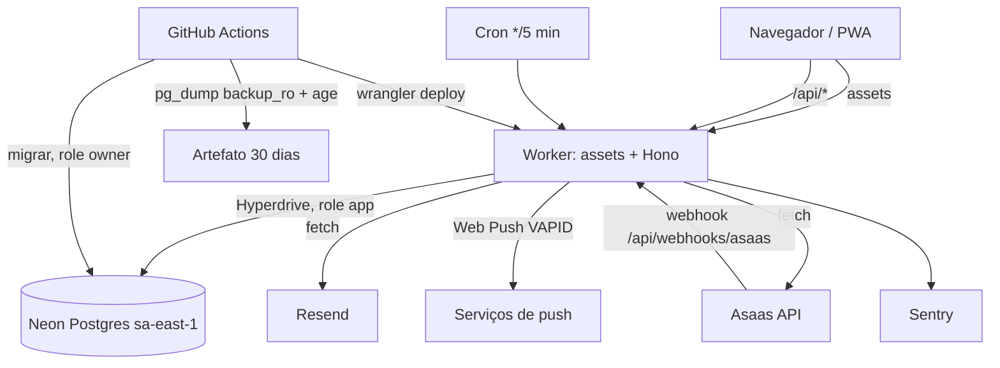
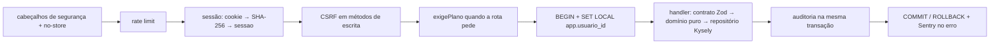

# Design: Evolução Segura

**Spec**: `.specs/features/evolucao-segura/spec.md`
**Contexto**: `.specs/features/evolucao-segura/context.md`
**Status**: Approved (usuário, 2026-10-24; fecha a fase 4 junto com a spec)
**Abordagem escolhida pelo usuário (2026-10-24)**: fatias verticais (esqueleto ponta a ponta primeiro, depois uma área por etapa) e base de migrations consolidada nova.
**Fatos técnicos**: pesquisa de 2026-10-24 (agente pesquisador), citada como [P-n] na seção "Fontes".

---

## Architecture Overview

Um único Worker serve o front (assets) e a API Hono em `/api/*`. Todo acesso ao banco passa pela API, numa transação por requisição com `SET LOCAL app.usuario_id`, e o RLS barra o resto. Tarefas agendadas (lembretes, plano, purga) rodam no mesmo Worker por um único Cron Trigger e só tocam o banco por funções `SECURITY DEFINER` estreitas, para que a role `app` continue sem DELETE e sujeita a RLS.



### Pipeline de uma requisição `/api/*`



Rotas públicas (cadastro, entrar, 2FA, recuperação, confirmação, desistência, webhook, health) pulam a sessão e o CSRF; o webhook pula também o rate limit público e usa o `LIMITE_WEBHOOK`.

---

## Code Reuse Analysis

Legado em `C:\Leandro\Projetos\EvolucaoSeguraWeb` (somente leitura). Copiar o arquivo, adaptar e trazer junto os testes dele.

### Existing Components to Leverage

| Componente | Origem no legado | Como usar |
| --- | --- | --- |
| Schemas Zod | `shared/src/*.ts` | Copiar para `backend/contrato/src`; dinheiro passa a centavos inteiros; remover IA, relatório, Google, whitelist |
| Domínio de agenda | `backend/src/scheduling/domain/{session,series,conflict,weekday-availability}.ts` + specs | Copiar para `backend/dominio`; acrescentar realizada → cancelada com guarda (AGE-08) e `cobravel` padrão falso (AGE-10) |
| Domínio financeiro | `backend/src/billing/domain/{debts,payment,price}.ts` + specs | Copiar; trocar decimal por centavos |
| Início | `backend/src/home/domain/summary.ts` + spec | Copiar |
| Janela de edição | `backend/src/clinical/domain/edit-window.ts` | Copiar (o cálculo do "dia" continua no banco) |
| Anamnese | `backend/src/clinical/anamnesis/anamnesis-values.domain.ts`, `clinical/model/{model.domain,presets}.ts` | Copiar; remover o schema morto de 20.000/5.000 de `anamnesis.domain.ts:14-28` |
| Política de senha | `backend/src/identity/domain/password-policy.ts` + spec | Copiar (lista de 124 senhas) |
| Rascunho e modelos | `backend/src/clinical/drafts/domain/draft.ts`, `clinical/templates/templates.domain.ts` | Copiar; modelo só do tipo `evolucao` |
| Evento de auditoria | `backend/src/audit/domain/audit-event.ts` | Copiar a lista; tirar ações de IA, relatório, Google e whitelist; acrescentar as novas (AUD-04) |
| Exportação completa | `backend/src/export/full/export-full.domain.ts` | Reaproveitar a lista de tabelas e o envelope JSON; sem CSV |
| Documento do PDF | `backend/src/export/pdf/record-pdf.ts` (pdfmake) | Portar a definição do documento para o front, com pdfmake no navegador |
| Migrations | `backend/migrations/0001–0035` | Fonte para a base consolidada nova (roles, helpers RLS, triggers de revisão, guardas) |
| Testes de garantia do banco | `backend/test/db-guarantees/` | Adaptar ao schema novo; base do teste de isolamento |
| Testes de contrato HTTP | `backend/test/contrato-http/` | Adaptar de `/v1` NestJS para `/api` Hono |
| Front inteiro | `frontend/src` (ui, tokens, features, shell, lib/api, fontes, ícones) | Copiar para `frontend/web/src`; router com base `/app`; cliente com prefixo `/api`; telas de auth trocadas |
| Restauração | `infra/backup/restore-test.sh` | Base do teste de restauração do runbook |
| Variáveis | `backend/src/platform/config/env.schema.ts`, `.env.example` | Base do schema de ambiente do Worker |

### Integration Points

| Sistema | Integração |
| --- | --- |
| Neon | Hyperdrive com `pg` (> 8.16.3) + Kysely; um `Client` por requisição [P-2] |
| Resend | `fetch` em `https://api.resend.com/emails`, texto puro, remetente `@evolucaosegura.com.br` (D-27) |
| Asaas | `fetch` em `https://api-sandbox.asaas.com/v3` (sandbox) ou `https://api.asaas.com/v3`; webhook autenticado por `asaas-access-token` [P-4] |
| Push | `@block65/webcrypto-web-push` (Web Crypto, RFC 8291) [P-7] |
| Sentry | `@sentry/cloudflare` e `@sentry/react` |

---

## Components

### `backend/contrato`
- **Purpose**: única fonte do contrato entre API e front (schemas Zod e tipos).
- **Location**: `backend/contrato/src/<area>.ts`
- **Interfaces**: um schema de entrada e de saída por rota, mais os códigos de erro (`SCHEDULE_CONFLICT`, `LIMITE_PLANO`...).
- **Dependencies**: `zod`.
- **Reuses**: `shared/src` do legado.

### `backend/dominio`
- **Purpose**: regras puras, sem I/O.
- **Location**: `backend/dominio/src/<area>/`
- **Interfaces** (exemplos): `transicaoPermitida(de, para, temRegistros): boolean`, `gerarOcorrencias(serie): Intervalo[]`, `conflitos(nova, existentes): Sessao[]`, `debitoPendente(sessao, pagamento): boolean`, `proximoEstadoAssinatura(estado, evento, agora): Estado`, `limitePacientes(plano, ativos): 'ok' | 'LIMITE_PLANO'`, `avaliarSenha(senha): Motivo | null`.
- **Dependencies**: `backend/contrato`.
- **Reuses**: domínio do legado (tabela acima).

### `backend/api`
- **Purpose**: Worker Hono; rotas, middlewares, repositórios, tarefas do cron, clientes de Resend, Asaas e push.
- **Location**: `backend/api/src/` com `rotas/<area>.ts`, `middleware/`, `repositorios/`, `tarefas/`, `integracoes/{resend,asaas,push}.ts`, `index.ts` (`fetch` + `scheduled`).
- **Interfaces**: `app.fetch(req, env, ctx)`, `scheduled(evt, env, ctx)`, `comTransacao(env, usuarioId, fn)`.
- **Dependencies**: Hono, Kysely, `pg`, `@sentry/cloudflare`, contrato, domínio.
- **Reuses**: serviços do legado como referência de comportamento (não de código, que era NestJS).

### `backend/scripts`
- **Purpose**: `migrar.ts` (node-pg-migrate 9, ESM), `seed-local.ts`, scripts de operação (reprocessar webhook, reativar usuário).
- **Location**: `backend/scripts/src/`, migrations em `backend/scripts/migrations/`.

### `frontend/web`
- **Purpose**: landing e páginas públicas em `/`, app em `/app`, PWA.
- **Location**: `frontend/web/src/` com `publico/` (landing, cadastro, confirmar, entrar, recuperar, termos, privacidade, desistir-exclusao), `app/` (shell e features portadas), `pwa/` (SW, push, instrução iOS), `export/` (pdfmake e fflate, carregados sob demanda).
- **Dependencies**: React 19, Vite, `vite-plugin-pwa` (injectManifest), React Router, TanStack Query, Tailwind v4, Radix (dialogs), `@sentry/react`, `pdfmake`, `fflate`.
- **Reuses**: `frontend/src` do legado.

### Tarefas do cron (`backend/api/src/tarefas/`)
- **Purpose**: um despachante chamado a cada 5 min que roda, em ordem e com orçamento de CPU: lembrete de sessão (janela 15–10 min), pendência das 20:00, avisos de plano, transições de assinatura (trial vencido, atraso de 7 dias, cancelada no fim), purga de contas, limpeza de tokens vencidos.
- **Interfaces**: `despachar(agora, env, ctx)`; cada tarefa é idempotente pela tabela `notificacao_enviada` (tipo, ref, chave única) ou pelo estado.
- **Dependencies**: funções `tarefas.*` `SECURITY DEFINER` no banco.

---

## Data Models

Base consolidada nova em `backend/scripts/migrations/`, uma migration por área. Toda tabela de negócio tem `usuario_id`, RLS com `FORCE`, `criado_em`; as editáveis têm `row_version`. Nenhuma tabela de negócio dá DELETE à role `app`.

| Área | Tabelas | Origem |
| --- | --- | --- |
| Base | roles `owner`, `app`, `backup_ro`; schema `tarefas`; helpers `app_usuario_id()`, triggers de `row_version` e de revisão | 0001, 0002, 0016 |
| Identidade (sem RLS, acesso por funções e grants mínimos) | `usuario` (e-mail, nome, `confirmado_em`, `bloqueado_exclusao_em`), `credencial_senha` (hash bcrypt), `sessao`, `desafio_2fa`, `token_email` (tipo: confirmacao, recuperacao, exclusao, desistencia), `tentativa_login`, `aceite_termos` | 0003 adaptada |
| Limites | `limite_uso` (chave, janela, contagem) para exportações e, se preciso, o rate limit em tabela | novo |
| Perfil | `perfil` (nome, contato, endereço, `atende_sabado`, `atende_domingo`, especialidade, nome da especialidade "outra", conselho, número, região), `configuracao_usuario` (`privacidade_agenda`) | 0005, 0014, 0026, 0027 (uma especialidade) |
| Anamnese | `modelo_anamnese`, `modelo_anamnese_item`, `anamnese` (`valores jsonb`, `modelo_revisao`), `anamnese_retificacao` | 0028, 0029, 0009 |
| Pacientes | `paciente`, `consentimento_tcle` | 0005 sem colunas de IA |
| Agenda | `serie_recorrencia`, `sessao_atendimento` (`cobravel` padrão falso) | 0008 |
| Evolução | `evolucao` (índice único parcial em `sessao_id`), `evolucao_retificacao`, `rascunho`, `modelo_texto` | 0010, 0011 |
| Financeiro | `preco_paciente`, `preco_sessao` (+ revisões), `pagamento` (UNIQUE por sessão; valores em `bigint` centavos) | 0013, 0017, 0022 |
| Auditoria | `audit_log` (só inclusão) | 0004 |
| Cobrança | `assinatura` (`plano`, `status`, `asaas_customer_id`, `asaas_subscription_id`, `periodo_fim`, `vencimento_atraso`), `webhook_evento` (`event_id` único, payload, processado_em) | novo (padrão LJS) |
| Push | `push_subscription` (endpoint único, chaves), `notificacao_enviada` (tipo, ref, única) | novo |
| Exclusão | `conta_excluida` (id, `pedido_em`, `purgado_em`) | novo |

```typescript
type EstadoAssinatura = 'trial' | 'ativa' | 'atrasada' | 'cancelada' | 'free'
interface Assinatura {
  usuario_id: string
  plano: 'pro' | 'free'          // 'pro' cobre trial, ativa, atrasada e cancelada até periodo_fim
  status: EstadoAssinatura
  asaas_customer_id: string | null
  asaas_subscription_id: string | null
  periodo_fim: string             // timestamptz
  vencimento_atraso: string | null // início da tolerância de 7 dias (D-21)
}
```

---

## Error Handling Strategy

| Cenário | Tratamento | O que o usuário vê |
| --- | --- | --- |
| Validação de contrato | 422 problem+json com `codigo` e campos | Mensagem no campo (componentes do legado) |
| Recurso de outro profissional | 404 idêntico ao inexistente (RLS devolve zero linhas) | "Não encontrado" |
| Conflito de versão | 409 | "Alguém alterou isto; recarregue" (texto do legado) |
| Limite do plano | 403 `LIMITE_PLANO` | Aviso com link para "Meu plano" |
| Resend fora ou sem cota | 503 `mail_unavailable` no 2FA; 202 nos fluxos anti-enumeração; Sentry com alerta | "Não foi possível enviar o código agora" |
| Asaas fora | 503 sem mudar estado local | "Cobrança indisponível, tente em instantes" |
| Webhook com erro de processamento | grava `webhook_evento` antes de processar; erro → 500 para o Asaas reenviar (a fila pausa após 15 falhas seguidas [P-4]); runbook explica reprocessar | — |
| Push 404/410 | remove a `push_subscription` | — |
| Erro não previsto | 500 genérico, Sentry com scrubbing, transação desfeita | "Algo deu errado" |
| Neon em cold start | sem tratamento especial; o tempo de espera não conta na CPU | Primeira tela mais lenta |

---

## Risks & Concerns

| Concern | Location (file:line) | Impact | Mitigation |
| --- | --- | --- | --- |
| Rate limit binding sem confirmação de disponibilidade no Free [P-1] | `wrangler.jsonc` (novo) | OPS-07 sem mecanismo | Spike S2 na preparação; se falhar, contador em `limite_uso` com os mesmos limites (ADR-006) |
| Binding conta por localização, não global [P-1] | — | Limite aproximado | Aceito: o bloqueio forte de login (AUTH-07) fica em tabela |
| `SET LOCAL` com pooler do Hyperdrive em modo transação (doc não cita `SET LOCAL` literalmente) [P-2] | `backend/api/src/db.ts` (novo) | Vazamento de contexto entre usuários | Spike S1 prova que `SET LOCAL` dentro de `BEGIN` vale só na transação; teste de isolamento roda contra Hyperdrive local no CI |
| Kysely + Hyperdrive sem exemplo oficial [P-2] | `backend/api/src/db.ts` | Configuração errada de conexão | Spike S1: Kysely sobre um `pg.Client` por requisição |
| CPU de 10 ms (bcrypt no banco, JSON grande da exportação) | rotas de auth e exportação | 1102 / erro no Worker | Hash só no Postgres (OPS-14); spike `cpu-exportacao` (2026-10-24) mediu ~1 s de CPU e 39,65 MB para a exportação inteira: a exportação passa a ser paginada por tabela com cursor (D-32), e o navegador junta as páginas, o PDF e o zip |
| `@cloudflare/vitest-pool-workers` descontinuado; nome novo `@cloudflare/vitest-plugin` (peer Vitest 4/5) [P-3] | `vitest.config.ts` | Padrão LJS cita o pacote antigo | ADR-003; pergunta ao usuário na aprovação do design |
| Asaas exige `cpfCnpj` no cliente [P-4] | Meu plano | Assinar sem CPF falha | Campo CPF/CNPJ no formulário de assinatura; validado com dígito verificador |
| QR Pix sem chave Pix cadastrada expira às 23:59 do dia [P-4] | Meu plano | Pix copiado vence | Pré-requisito do runbook: cadastrar chave Pix na conta Asaas de produção; o app busca o QR na hora de mostrar |
| Resend 100/dia com 2FA em todo login | `integracoes/resend.ts` | Login para de funcionar | Alerta no Sentry ao primeiro 429 do Resend; plano B no runbook |
| Artefatos do Actions: 500 MB no total | `backup.yml` | Backup para de gravar | Medir o dump no primeiro backup; registrar no runbook o tamanho e o limite |
| Testes do legado não estão verdes | `backend/test/**` do legado | Trazer falha junto | Cada teste copiado roda verde aqui antes do commit; o que não fizer sentido no schema novo é reescrito a partir do critério da spec |
| pdfmake no navegador: tamanho do bundle e acentuação não confirmados [P-6] | `frontend/web/src/export/` | Tela lenta ou PDF com caracteres trocados | Carregar sob demanda (chunk separado); teste com texto acentuado na etapa da exportação; fonte embutida |
| Funções `SECURITY DEFINER` mal escritas | migrations `tarefas.*` | Escalada de privilégio | `search_path` fixo, parâmetros tipados, sem SQL dinâmico; teste que a role `app` não executa nada fora da lista |

---

## Tech Decisions

| Decision | Choice | Rationale |
| --- | --- | --- |
| Conexão ao banco | `pg.Client` por requisição via Hyperdrive, envolvido pelo Kysely; `client.end()` em `ctx.waitUntil` | Recomendação da Cloudflare [P-2] |
| Tarefas e webhook fora da sessão | Funções `SECURITY DEFINER` no schema `tarefas`, executáveis pela role `app` | Mantém `app` sem DELETE e sem BYPASSRLS; um só Hyperdrive |
| Cron | Um trigger `*/5 * * * *` com despachante | 5 crons por conta, divididos entre 3 apps |
| Push | `@block65/webcrypto-web-push` com payload cifrado | Web Crypto (satisfaz "ES256 com crypto.subtle"); payload cifrado permite abrir a tela certa (PUSH-08) |
| PDF | pdfmake no navegador, chunk sob demanda | Reaproveita a definição do documento do legado (`record-pdf.ts`) |
| Zip | `fflate` | ~11 kB, tree-shakeable [P-6] |
| Testes do Worker | `@cloudflare/vitest-plugin` com Hyperdrive local por `miniflare.hyperdrives` | Sucessor oficial do pacote do padrão [P-3]; troca aprovada pelo usuário em 2026-10-24 (AD-001) |
| Commits | Um commit atômico por tarefa; relatório LJS (feito, como validar, próxima) ao fechar cada etapa | Escolha do usuário em 2026-10-24 (AD-002) |
| Postgres | 16 no Docker, no CI e no Neon; `pg_dump` 16 | Padrão LJS (Postgres 16); Neon suporta [P-8] |
| Backup e branches | `pg_dump` em conexão direta (sem `-pooler`); `neondatabase/create-branch-action@v5` e `delete-branch-action@v3` | Doc do Neon [P-8] |
| Migrations | node-pg-migrate 9 (ESM) | Padrão LJS [P-9] |

---

## Plano em etapas (padrão LJS, seção 7)

Cada etapa é uma fase do `tasks.md`, com tarefas atômicas (um commit por tarefa, com teste e gate). Ao fechar cada etapa, o relatório diz o que foi feito, como validar e o que vem a seguir. Esforço: **P** até 1 dia, **M** 2 a 3 dias, **G** 4 dias ou mais (estimativa relativa).

| # | Etapa | Requisitos | Esforço | Riscos principais | ADRs criados |
| --- | --- | --- | --- | --- | --- |
| 1 | Preparação: monorepo, ferramentas, Docker Postgres, `testes.json`, CI, `.md/` (PRD, PRD-TECNICO, SDD, GUARDRAILS, THREAT-MODEL a partir da spec), spikes S1 (Hyperdrive + Kysely + `SET LOCAL` + CPU), S2 (rate limit no Free), S3 (Asaas sandbox: cliente, assinatura Pix, QR, webhook), S4 (push no Worker) | OPS-05, OPS-11 | M | Spikes podem mudar ADRs | 001 Stack e monorepo LJS; 002 Base de migrations consolidada; 003 `@cloudflare/vitest-plugin` |
| 2 | Esqueleto ponta a ponta: Worker com assets e Hono, `/api/health`, cabeçalhos, Sentry, `wrangler dev` com Hyperdrive local, `deploy.yml` (ordem fixa) e `backup.yml`, teste "só um `wrangler deploy`" | OPS-03, OPS-04, OPS-06, OPS-08, OPS-09, OPS-10, PUB-05 | M | Hyperdrive local no CI | 004 Deploy e backup no Actions |
| 3 | Banco base: roles, helpers RLS, `audit_log`, schema `tarefas`, transação por requisição, harness do teste de isolamento | ISO-01..04, AUD-01, AUD-02, OPS-13 | M | `SECURITY DEFINER` | 005 RLS, transação por requisição e funções de tarefa |
| 4 | Acesso: cadastro, confirmação, aceite de termos, login com 2FA, sessão, CSRF, recuperação, sair, rate limit, Resend; telas públicas e aviso de inatividade | CAD-01..09, AUTH-01..19, OPS-07, AUD-04 (parte) | G | Resend 100/dia; CPU do bcrypt | 006 Auth própria (bcrypt no Postgres, 2FA, sessão opaca) e rate limit |
| 5 | Perfil, especialidade, configurações e shell `/app` portado | PERF-01..09, PUB-02 (shell) | M | Layout idêntico | — |
| 6 | Pacientes e TCLE | PAC-01..07 | P | — | — |
| 7 | Agenda e séries | AGE-01..17 | G | Fuso e recorrência | — |
| 8 | Anamnese configurável | ANA-01..09 | M | Bloqueio do modelo | — |
| 9 | Evoluções, rascunhos e modelos de texto | EVO-01..07, RAS-01..04 | M | Janela do dia | — |
| 10 | Financeiro e Início | FIN-01..08, INI-01..03 | M | Centavos × decimal do legado | 007 Dinheiro em centavos no contrato |
| 11 | Auditoria (telas) e exportação (PDF e zip no navegador) | AUD-03, EXP-01..07 | M | Bundle e acentos do pdfmake; CPU do JSON | 008 PDF e zip no navegador |
| 12 | Planos, Asaas, "Meu plano", limite do Free e cron único | PLANO-01..15 | G | Webhook e estados; conta de produção ausente | 009 Cobrança Asaas e máquina de estados; 010 Cron único com despachante |
| 13 | Push | PUSH-01..08 | M | Lib de push no Worker | 011 Web Push com Web Crypto |
| 14 | Exclusão de conta, termos, privacidade, landing, PWA e instrução iOS | CONTA-01..06, PUB-01, PUB-03, PUB-04 | M | Purga com `SECURITY DEFINER`; texto jurídico | 012 Exclusão e purga de conta |
| 15 | Fechamento: e2e Playwright (cadastro, login, assinar, fluxo principal), restauração a partir de cópia limpa, README e runbook | OPS-01, OPS-02, OPS-12, Success Criteria | M | Restauração | — |

Ao fim da etapa 15 roda o verificador (fase 7 do fluxo), depois a auditoria de segurança e só então a implantação (fase 8), com confirmação específica para publicar.

---

## Fontes

- [P-1] developers.cloudflare.com/workers/runtime-apis/bindings/rate-limit/ e changelog 2025-09-19 (GA); disponibilidade no Free não encontrada.
- [P-2] developers.cloudflare.com/hyperdrive/examples/connect-to-postgres/postgres-drivers-and-libraries/node-postgres/ e .../hyperdrive/concepts/how-hyperdrive-works/
- [P-3] registry.npmjs.org/@cloudflare/vitest-plugin (1.4.7) e @cloudflare/vitest-pool-workers (descontinuado); developers.cloudflare.com/workers/testing/vitest-integration/configuration/
- [P-4] docs.asaas.com: criar-novo-cliente, criar-nova-assinatura, obter-qr-code-para-pagamentos-via-pix, receba-eventos-do-asaas-no-seu-endpoint-de-webhook, sandbox
- [P-5] github.com/GoogleChrome/lighthouse/releases/tag/v12.0.0 (categoria PWA removida)
- [P-6] registry.npmjs.org (pdfmake 0.3.12, @react-pdf/renderer 4.9.0, jsPDF 4.2.1); README do fflate
- [P-7] registry.npmjs.org/@block65/webcrypto-web-push (2.0.0)
- [P-8] neon.com/docs/manage/backup-pg-dump e neon.com/docs/guides/neon-github-integration
- [P-9] registry.npmjs.org/node-pg-migrate (9.0.0)

Todas consultadas em 2026-10-24.
